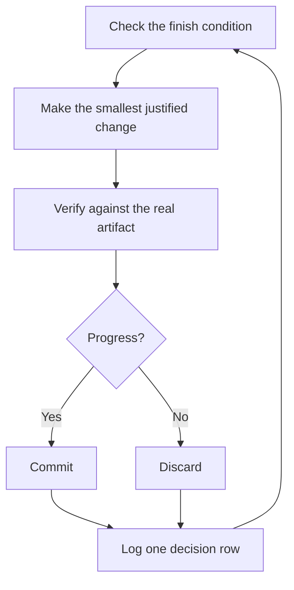

# Run work while you sleep

This is the payoff for everything before it. An agent you can trust to verify its own work is an agent you can leave alone with a hard task. What makes that safe is not hope. It is a checkable finish condition, an isolated worktree, and a decision log you audit in the morning.


## Earn the trust before the loop

A loop you do not trust just produces unchecked work faster, and the mess compounds with every iteration. Before you leave one running, check that it has earned it:

- You have done the task once by hand, or watched an agent do it, so you know what good looks like.
- The agent has the tools and signals you would use yourself: the verification skill, the profiler, the logs.
- Every stage proves its work and can stop the line when the work misses the bar.
- You have read a few transcripts and turned the repeated failures into tools, skills, or checks.

Make the loop autonomous only after all four hold. Until then, run it while you watch.

## The overnight contract

A good handoff has the goal, the finish condition, permissions, and an escape hatch. It does not need to be long:

```text
/poteto-mode im going to bed. migrate every caller to the new parser in a fresh worktree off main.
done means zero old callers, all parser fixtures pass, old api deleted.
keep a decision log. don't ask me before committing.
if you're truly stuck after a few hours, stop and write up why.
```

Then arm the loop with a prompt and a predicate:

```text
/loop 20m --until 'npm test -- parser' keep going and verify the predicate.
```

Walk through what each line buys you:

- "im going to bed" is a session override. The agent stops asking and keeps going.
- "done means..." turns the goal into checks every iteration can run.
- "fresh worktree off main" keeps the run from colliding with anything else you have open.
- "don't ask me before committing" pre-answers the permission the agent would otherwise block on.
- `/loop` is omp's built-in loop, not a pstack skill. The prompt is what each iteration runs.
- The escape hatch lets it stop at a genuine dead end and write up why, which beats eight hours of creative goal reinterpretation.

`/loop` takes an optional limit and an optional continue condition before the prompt:

```text
/loop 10                      ten iterations
/loop 10m                     ten minutes
/loop 20 --until 'bun test'   up to twenty iterations, while the command fails
```

`--until` continues while the command exits non-zero and stops when it exits zero. `--while` is the reverse. Exit 1 means "condition is false". A higher status, such as 127 for a missing command, means the condition itself is broken, and omp stops the loop with an error instead of reading it as finished work. A `/loop` with no limit runs until you interrupt it. With no prompt, it waits for your next prompt and repeats that.

For a long run, pin the objective where it survives context compaction:

```text
/goal set zero old parser callers, all fixtures pass, old api deleted
```

`/goal show`, `/goal pause`, `/goal resume`, `/goal drop`, and `/goal budget` manage it. Goal mode keeps the objective in the session across turns.

Because you will review this work after stepping away, `/poteto-mode` routes it through [`/skill:figure-it-out`](../../skills/figure-it-out/SKILL.md), which designs the run's phases before any code and wires in the decision log.

## What the loop does all night



One change, one check, one log row, every iteration. Changes that did not help get discarded, not left to ride. A plateau means pivot, not stop, and the finish condition never quietly relaxes to declare victory.

To stop a run on purpose, tell the agent to pause, or that you are about to go offline. The [Pause safely playbook](../../skills/poteto-mode/playbooks/pause-safely.md) finishes or backs out of the current step, commits a work-in-progress checkpoint, and writes a resume note. A fresh chat picks the work up from that note through the Session pickup playbook. Saying "keep going" never triggers a pause.

## The morning audit

[`/skill:show-me-your-work`](../../skills/show-me-your-work/SKILL.md) is what makes the run reviewable. Each row records the time, phase, decision, reason, an evidence pointer, and the result, in a TSV at `decisions.tsv` (or `.audit/<task-slug>.tsv` when several runs share a directory). It stays local by default. Commit it when the work is ambitious enough that a reviewer needs the trail to trust the result.

When you are back, ask for the run in review form:

```text
/skill:show-me-your-work catch me up on what you did last night
```

Before the skill hands back its summary, it spawns a reviewer on a different model family to read the trail and the transcript, and the reply ends with an Attention section listing what deserves your scrutiny. Read that section first, then the log rows it points at. You are auditing decisions, not re-reading the whole night.

For a quick status instead of an audit, run [`/skill:ketchup`](../../skills/ketchup/SKILL.md) in the chat that ran the work. It reads only, and tells you in plain words what changed since your last message, with the screenshots and small diagrams the work produced. Then it lists each call waiting on you, such as a merge, an approval, or a choice between options, with its pick, the evidence, and the risk, so you can decide from the reply alone. [`/skill:ketchup-video`](../../skills/ketchup-video/SKILL.md) shows the same catch-up as a short subtitled video.

## When the night holds a queue, not a task

The contract above drives one task to one finish condition. Some nights hold more, a queue of independent changes or a whole program. Two playbooks scale the same trust up.

[Autopilot-full](../../skills/poteto-mode/playbooks/autopilot-full.md) runs a queue of independent PRs to merged. Each PR gets one owner agent that carries it from build through merge, and no owner merges on its own verdict. A swarm of fresh verifiers checks the owner's code-ready head. A later rebase or minor fix gets one fresh verifier, and only new behavior or a large new diff calls the full swarm again. Only a clean verdict on the patch that merges authorizes the merge:

```text
/poteto-mode full autopilot on this queue. each item is independent. i want them merged by morning.
```

[Autopilot-stack](../../skills/poteto-mode/playbooks/autopilot-stack.md) is Autopilot-full without the merge. You wake up to verified PRs, each with its verdict, and you review and land them yourself. A PR stacks only on a PR it builds on. Pick it over Autopilot-full when you want your own eyes on the work before anything merges:

```text
/poteto-mode autopilot these five changes, but don't merge. i'll land them in the morning.
```

A whole program, such as a migration across many packages, has no playbook of its own. `/poteto-mode` routes large or cross-cutting work to [`/skill:figure-it-out`](../../skills/figure-it-out/SKILL.md), which designs one rigorous run for it:

```text
/poteto-mode migrate every package to the new store. own it until each one is converted and merged. i'll check in twice a day.
```

Every owner, verifier, and worker runs locally, so a queue night is bounded by your machine. Isolate parallel owners in worktrees, and keep the queue small enough that the machine stays responsive.

## Clean up the worktrees afterward

A queue night leaves worktrees behind. When disk gets tight, ask:

```text
/poteto-mode what's eating my disk? prune the worktrees that are safe to prune.
```

The [Worktree cleanup playbook](../../skills/poteto-mode/playbooks/worktree-cleanup.md) runs [`scripts/worktree-audit.sh`](../../skills/poteto-mode/scripts/worktree-audit.sh) to classify every worktree by size, age, merge state, uncommitted work, PR state, and the newest chat that touched it. It checks pinned chats before trusting a `safe` label, deletes merged and unused worktrees with `git worktree remove --force`, then prunes. A clean merged worktree is recoverable from its branch. Uncommitted work is not, so the playbook pauses for your call on any worktree holding it.

**Pitfall:** a duration is not a finish condition. "work on this for 4 hours" gives the loop nothing to check, and you will wake up to four hours of motion instead of a result. Give `/loop` a predicate that can pass or fail.

Next: [Steer with principle names](./08-principles.md).
