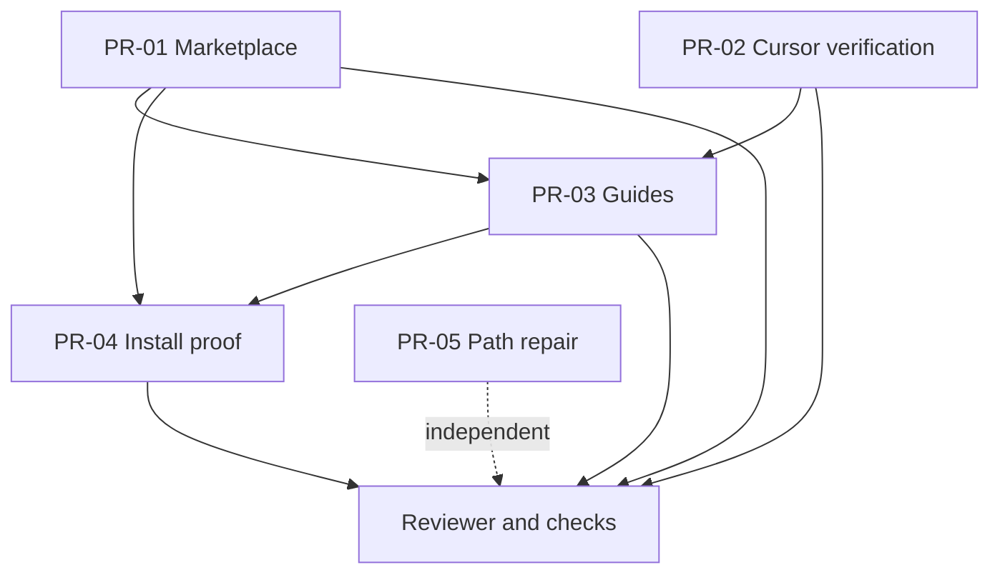

# 借鑑 Jrecos 的實作計畫

## 目標

把已批准的五項工作拆成可驗證的交付，並避免把對方的實作帶進本 repo。

**本計畫只交付規劃與審核結果。實作要等操作者明確下達開始指令。**

批准範圍：repo 直接 marketplace、完整使用指南、Cursor-only 上游驗證、安裝證據、marketplace 升級後的路徑修復。

不做的範圍：模型路由驗證器、native capabilities 文件、bare command、統一 CLI、session-review、native skill 自動啟動、system prompt 注入、自然語言關閉 mode、Benny、routines、Spec Kit、pi-mimir 追蹤。

## 從頭重寫的約束

- 只借用原理、設計意圖、功能邊界與證據分類。不得直接複製或貼上 Jrecos 的 `src/`、`scripts/`、tool implementations 或其自製功能文件。
- 新程式一律以本 repo 的 `.mjs`、`.ts`、Node test、Bun extension test 和 GitHub Actions 慣例重新撰寫。不得為形似而引入 Bun CLI、commander、SQLite、Docker、Slack、tracker 或 `src/` runtime。
- manifest、proof 和 `Anchor` 的 schema 為本 repo 新設計，名稱與資料內容不必與 Jrecos 相同。
- Cursor 原始 skill 文件、guide 和圖片可保留 MIT 授權與原作者署名。Jrecos 對這些內容的改寫不可直接照搬。每段 guide 都以 Cursor 原文及本 repo 的實際行為重新撰寫。
- 對照的原始依據是本 repo 的 19.2.1 public types、本機原始碼和實際 OMP 指令結果，不能假設 Cursor host 與 Jrecos 的 SDK 版本一致。

這不是 fork Jrecos 的 repo。這是將五個功能獨立實作在本 repo 的現有架構上。

## PR 順序與相依關係

| PR | 工作 | 相依關係 | 主要變更範圍 |
|---|---|---|---|
| PR-01 | 直接 marketplace 安裝與共用安裝驗證 | 無 | `.omp-plugin/`、`README.md`、`AGENT-INSTALL.md`、`scripts/`、`skills/poteto-help/`、`tests/` |
| PR-02 | Cursor-only 同步與逐檔驗證 | 無 | `.gitattributes`、`.gitignore`、`upstream.json`、`scripts/`、`.github/` |
| PR-03 | 完整使用指南與 skill 索引 | PR-01、PR-02 先合併 | `docs/`、`NOTICE.md`、`scripts/` |
| PR-04 | 安裝證據與 read-only freshness | PR-01、PR-03 先合併 | `proofs/`、`scripts/`、release workflows |
| PR-05 | mode 的路徑修復 | 無，若在 PR-04 後執行需重跑 proof | `extensions/pstack/`、`tests/`、`scripts/`、`.github/` |



圖中每個箭頭都是真實的排程依賴。PR-05 獨立，只有和 PR-04 重疊時才一起帶證據變更。

每個 PR 單獨從 `main` 開出，最後一次修改後執行 `npm run check` 與自身的 live smoke。每個 PR 都要經 Reviewer 審核。PR-04 完成後，任何修改 proof inputs 的 PR 都必須帶上重新產生的證據。

若先執行 PR-02，`.gitattributes` 應在該 PR commit 先落地，不能留到最後才改。fresh Windows checkout 的文字檔有了 LF，byte-to-byte upstream 驗證和 cross-platform evidence hash 才有同一基準。


## 交付的共同契約
1. 先加可觀察到問題的失敗測試，再做最小修正。
2. 新指令重跑必須收斂到相同結果。JSON 由固定排序產生，去除暫存路徑、timestamp、token 與 host-specific observation。
3. production 安裝保持零 npm runtime dependency。extension 只用 Node 和 repo 內相對 import，不使用 `@oh-my-pi/pi-utils`。

每個 PR 都要走 requestor 要求的 Reviewer 獨立審核流程。沒有 live smoke 的證據就不能把「符合原始碼預期」寫成「實際可用」。

4. 跨平台測試用真實 `.omp` 路徑、POSIX link 和 Windows junction。絕不使用不存在的 `file://` marketplace 傳輸。

新增 `.gitattributes` 的 `* text=auto eol=lf`，讓 Windows 的 LF 驗證與其他平台 checkout 一致。enabled file modes 在 Windows 的 check 比照既有 `tests/skills.test.mjs` 的 conditional skip，不把 Windows 沒有的 executable bit 誤報為文件變更。
5. 文件新增的相對連結必須通過既有的 `tests/skills.test.mjs` 檢查。

6. 文件與 script counts 都從目前的 skills、playbooks、package metadata 計算，不寫死計數的重複來源。
7. 每個 PR 更新 `CHANGELOG.md`、本文件的 checkbox，以及對應的使用者文件。仍保留 Cursor / pi-pstack 的 MIT attribution，不把停止追蹤寫成來源不存在。
8. 這些工作不追求效能改善。最後紀錄完整測試是否在各 workflow 的 timeout 內完成，不宣稱速度、成本或品質提升。

## PR-01 直接 marketplace 安裝與共用安裝驗證

### 交付行為

使用者能把這個 repo 加入 OMP 作為 marketplace，然後安裝 `omp-pstack@omp-pstack`。npm 和舊 marketplace catalog 仍是 repo 外部提供的安裝來源。

**同一台 OMP 安裝範圍中，npm、舊 entry 和新 entry 不能同時使用同名 runtime package。** 文件要提供先卸載再安裝的切換路徑。不能宣稱安裝來源可共存於同一個 runtime。

### 自己的 marketplace 定義

新增 `.omp-plugin/marketplace.json`。以本機 19.2.1 的 parser schema 驗證：

```json
{
  "name": "omp-pstack",
  "owner": { "name": "SenCha930511" },
  "plugins": [
    {
      "name": "omp-pstack",
      "source": "./",
      "description": "pstack skills, Poteto Mode, and bundled agents for omp (oh-my-pi)."
    }
  ]
}
```

對應命令：

```sh
omp plugin marketplace add SenCha930511/omp-pstack
omp plugin install omp-pstack@omp-pstack
```

`"./"` 對 GitHub 來源會讀取 catalog 當時取得的 repo tree，不是實際使用者 checkout。它不代表每次 install 都重新抓 latest main。更新文件必須要求先 `omp plugin marketplace update omp-pstack`，後再安裝或更新。不要把未 tag 的內容宣稱為已發佈版本。

OMP 19.2.1 將整個 catalog tree 複製進使用者 plugin cache，包括 `.git/`、tests、scripts 與新增的 guide images。npm 的 `files` 白名單不適用。這是 repo-as-catalog 的代價，不用 `.npmignore` 冒充解決。guide 圖片沿用原檔案，文件要明列此行為。

OMP 只比較版本號。若 main 新增 commits 但版本號未變，`omp plugin upgrade` 不會視為新版。對未升版的 head 測試使用具名 `upgrade omp-pstack@omp-pstack` 或 `install ... --force`，不宣稱無參數 upgrade 會更新尚未升版 source。

外部 `SenCha930511/omp-marketplace` 仍可使用，但要文件區分：

- 若已使用 npm，改走新 marketplace 前先移除同名 npm runtime package。
- 若已安裝 `omp-pstack@sencha930511`，先卸載它，再安裝 `omp-pstack@omp-pstack`。
- 升級新 entry 時，先更新 own catalog，再用目前 OMP 支援的 plugin upgrade 或 force reinstall。
- 卸載和安裝後重啟 OMP，再驗證 hide mode 與 skill discovery。

### 共用 OMP discovery 驗證器

重新寫一個 `scripts/verify-install.mjs`，把現有 `test-packed.mjs` 的 discovery 驗證抽成純函式。`test-packed.mjs` 保持現有兩個調用方式，但把重複的驗證邏輯換成這個共用函式。

驗證器只接受測試自建的隔離 location。子行程 `env` 明確刪除 `XDG_DATA_HOME`、`XDG_CONFIG_HOME`、`XDG_STATE_HOME`、`XDG_CACHE_HOME`、`PI_CONFIG_DIR`、`OMP_PROFILE`、`PI_PROFILE`，再設定隔離的 `HOME`、`USERPROFILE`、`PI_CODING_AGENT_DIR`。宿主的 XDG、profile 或 config override 不能使測試逸出。

輸入只允許測試產生的安裝資料，不讀使用者 home：

```js
{
  sourceRoot,
  installedRoot,
  home,
  agentDir,
  packageName,
  expectedSkills
}
```

驗證器必須執行 `loadSkills`、`discoverAgents`、`loadExtensions`，並回傳可序列化的真實結果：

```js
{
  hostVersion,
  discoveredSkillNames,
  discoveredAgentNames,
  extensionCount,
  extensionErrors,
  runtimeDependencyNames
}
```

- 判斷 source skills 與 discovered skills 完全一致。
- 驗證 `poteto-agent` 的 `autoloadSkills` 和 `spawns`，以及 `comment-sicko` 的工具。
- 驗證 extension 無 error，且 runtime package 沒有 runtime dependencies。
- 自帶隔離的 `HOME`、`USERPROFILE`、`PI_CODING_AGENT_DIR`，用完刪掉暫存內容。宿主 overrides 按上述 env 清理。
- 不用 snapshot assertion。每個斷言都對應使用者能看到的安裝/探索結果。

### 正版 local marketplace 測試

新建 `scripts/test-marketplace.mjs`。OMP 19.2.1 的 `classifySource()` 不接受 `file://`。它接受本機相對路徑與絕對路徑。

先用 `git archive` 把當前 commit 展開到測試暫存資料夾，排除 `node_modules/`、`.git/` 和未追蹤檔案。然後使用絕對路徑：

```sh
omp plugin marketplace add /absolute/path/to/catalog-copy
omp plugin install omp-pstack@omp-pstack
omp plugin list --json
```

Windows 傳入 `C:\...` 路徑，測試路徑需含空格。`omp plugin list --json` 要檢查 `marketplace[].entries[].installPath`，而不能沿用現有 `plugins.npm` 的判斷。

- 先把隔離 home 建好再跑兩次相同安裝，觀察 host 的自然預期失敗或重試行為。不要把不支援的安裝重試假設為預設工作。
- 實測 `marketplace update` 與 host 支援的 update 方式，再比對 discovery。
- 直接在 pruned 暫存複本上測試，不會把整個 node_modules 複製到 cache。
- 準備第二個離線 temp marketplace，名字是 `sencha930511`，source 是 pruned copy。用它安裝舊 entry，再接著測試新 entry 的同名 runtime package 衝突。`npm run check` 不因測試而連線 GitHub。
- 在乾淨 home 才能測試完整成功安裝。

接線：`"test:marketplace": "node scripts/test-marketplace.mjs"`，加入 `npm run check`。Linux、macOS、Windows 的既有 CI 都執行。

### 驗收

- [ ] `npm run test:marketplace` 在乾淨 home 通過實際 add、install、list、discovery。
- [ ] 同名舊 runtime 的衝突路徑完全離線測試，錯誤明確，文件有遷移方式。
- [ ] 沒有未刪除的 XDG、profile 或 config location override 能影響測試位置。
- [ ] `npm run test:packed` 仍能完成原有的 tarball、link、extension、model catalog 驗證。
- [ ] `README.md`、`AGENT-INSTALL.md`、`skills/poteto-help/SKILL.md` 與 `tests/skills.test.mjs` 的 install 指引和 assertion 一致。
- [ ] 文件描述 complete-tree cache 複製與具名 upgrade/force reinstall 的行為，未宣稱無參數升級會取得未升版 head。

`test-packed.mjs` 在新增該內容的 PR 同步 deny repo-only metadata。PR-01 排除 `.omp-plugin/`，PR-02 排除 `upstream.json`，PR-03 排除 `docs/`，PR-04 排除 `proofs/`。這些 exclusions 不可延後到 PR-04 才一次補，避免 branch 中間跳出不相符 artifacts。

`test-packed.mjs` 的 forbidden 排除依新增內容引入時的 PR 更新。PR-01 排除 `.omp-plugin/`，PR-02 排除 `upstream.json`，PR-03 排除 `docs/`，PR-04 排除 `proofs/`。不提早來一輪 multi-PR bundle。
- [ ] `npm run check` 完整通過。
- [ ] 從當前 PR commit 的 GitHub branch URL 做一次 add/install/list smoke。不先改使用者的現有安裝。
- [ ] 文件沒有 `file://`，也沒有同名 runtime 可以並存的說法。

## PR-02 Cursor-only 同步與逐檔驗證

### 交付行為

上游同步只追蹤 Cursor `cursor/plugins`。所有 `pstack/skills/` 的檔案有正式分類與 git blob hash，但 `adaptedSkills` 仍是 daily flow 的主要移植分類。單一 upstream commit 同時驅動 sync config 和 manifest。

實際 baseline 已用真實 clone 驗證：

- pinned commit `9e278fe4d4ecd8bfe98b1b79bf4be662efb338cc`。
- upstream 樹有 516 個 skill-related files。
- 本地有 515 個對應檔案，缺 `make-bot-ui/SKILL.md`。
- 33 個本地檔案 bytes 不同。不能假設只有 17 個 adapted skill name 就等於同數量的改編檔案。

### 資料形狀

新增 `upstream.json` 作為新格式，不照抄 Jrecos：

```json
{
  "schema": "omp-pstack.upstream/1",
  "source": {
    "repository": "https://github.com/cursor/plugins",
    "path": "pstack/skills",
    "commit": "<same-as-cursor.lastSyncedSha>",
    "tree": "<pstack/skills tree hash>"
  },
  "entries": [
    {
      "source": "pstack/skills/how/SKILL.md",
      "target": "skills/how/SKILL.md",
      "blob": "<40-char git sha1>",
      "mode": "100644",
      "rule": "local",
      "reason": "Use OMP scout and keep the investigation report contract.",
      "tests": ["tests/skills.test.mjs"]
    }
  ]
}
```

`rule` 只用三種：

- `verbatim`。本地檔案必須存在且 byte-identical 到記錄 blob，不需 reason。
- `local`。本地存在但與 upstream 不同。reason 和 `tests` 必填，允許 nested files 各自改編。
- `excluded`。已決議不移植的上游檔案。reason 必填，缺 local 是預期情況。

每個 upstream file 都要有唯一 entry。`target` 必須只替換固定的 `pstack/skills/` 和 `skills/` 前綴。拒絕 symlink root、絕對路徑、`..`、重複 source/target 和不同 source 對應同一個 target。

### 保留分類相容性

新增 `scripts/check-upstream.mjs` 和 `scripts/test-check-upstream.mjs`，由本 repo 重寫邏輯：

1. 用真實 git `ls-tree -r <commit> -- pstack/skills` 取得 source paths、git blob SHA 和 mode。
2. 用 `git cat-file blob <sha>` 取得內容時走 `execFileSync`，不經 shell。
3. 驗證 `source.commit === config.cursor.lastSyncedSha`。
4. `config.cursor.adaptedSkills` 繼續表示「這個 skill 不自動覆蓋」。它與檔案的 content rule 分開。其下檔案只要與 upstream 相同就用 `verbatim`，不同的用 `local`；沒有改動的檔案不需硬填 adapt reason。
5. 名單外 byte 相同的檔案用 `verbatim`，不同的用 `local`。
6. `make-bot-ui` 使用 `excluded`，reason 指向本 repo 對 OMP routines 不在範圍的決定。
7. 新出現 blocked skill 用 `local`，其 reason 記錄「contains Cursor-only references and has blocked auto-copy」及其被 sync report 偵測到的檔案與 pattern。這代表尚未完成 port，不能接受 verbatim。
8. 本地與 upstream 都缺 target 的 entry，只有 `excluded` 才能存在。
每筆 `local` entry 的 `reason` 是 OMP adaptation 的可讀依據。nested upstream unchanged file 可以與同 skill 的改編分別記錄，不能把每筆 change 原因都說成已自動通過行為測試。


9. `source.tree` 由 `git rev-parse <commit>:pstack/skills` 取得，防止 commit 對但記錄的 upstream 內容不對。
10. 初始化檢查會一次列出所有不符合分類的檔案，先補理由與測試 artifact，不能靜默接受。

`tests` 只指名這筆 entry 的驗證 artifact。初次建立時逐檔比對差異及現有測試，例如 `how` 指向 `tests/skills.test.mjs` 和對應測試名稱。checker 驗證合適 artifact 存在，且被 `package.json` 中 `npm run check` 的測試腳本直接或間接涵蓋。共享 artifact 只執行一次，不是每筆各自跑一次。只有 link/frontmatter 的記錄不足以證明語意改編。

### 明確的日常寫入者

更新 `scripts/sync-upstream.mjs` 與 `scripts/sync-ack.mjs`，統一 baseline/pending 的契約：

- 每個新或更新的 copied file 在 `copiedVerbatim` 記錄完整 `{ source, target, blob, mode }` 物件，不能只存 path strings。blocking items 要有 reason，但 pending 的 new blobs 不倒寫成 baseline。
- new blocked 或待 port skill 記在 `pending.unresolved`，包含阻擋 pattern 和 file reference。等待人工 port 時**不把未完成內容當作已承認的 `local` entry**，更不得用 `verbatim` 驗證它。
- `sync:ack` 接受 `--cursor-dir`，在 resolved upstream clone 驗 HEAD、tree hash。有 pending 時驗 `pending.commit`，不寄希望于後來任意 clone 的最新 upstream HEAD；沒有 pending 時依 `--cursor` 的 resolved tree。`--adapt-only` 不推進 baseline pin。

### 是否已解決的資料和 ack 關係


`pending.commit` 若存在必需驗它的 `source.tree` 與此 option tree match。它是 optional，issue-only 不產生此 pending。

pending 的資料形狀示例：
```js
"pending": {
  "commit": "<resolved upstream head>",
  "tree": "<upstream skills tree>",
  "copiedVerbatim": [
    {
      "source": "pstack/skills/<skill>/SKILL.md",
      "target": "skills/<skill>/SKILL.md",
      "blob": "<resolved git blob>",
      "mode": "100644"
    }
  ],
  "unresolved": ["..."]
}
```

PR 的 `Verify synced repository` 先以 `pending.copiedVerbatim` 的 source/target/blob/mode 對照自動複製的檔案。剩餘檔案再走 baseline offline comparison。這樣已更新的 verbatim 不會與舊 blob 比對而 fail，新複製的檔案也不會被誤判為未登記孤兒。


offline check version 時，pending entries use own content blob validation vs source actual bytes，remaining baseline checks 才另算。老 baseline 不被偷偷改成尚未 ack 的新 input。
- 有 `pending`：驗證 resolved commit、tree、manual items 是否都完成，成功後清除。`unresolved` 未完成時不可刪除 staging。

`sync:ack` 不需要假設 pending 永遠存在。issue-only 的 adapted/blocked updates 不產生 pending：

- 有 `pending`：驗證 resolved commit、tree、manual items 是否都完成，成功後清除。`unresolved` 仍有未 port items 時不可刪除 staging。
- 沒有 `pending`：直接依 `--cursor` 搭配指定 `--cursor-dir` 的檢查結果更新 baseline 和 entries，而不是強求 pending commit。該證據必須包含完成 issue 中全部 manual items 的結果。

`--adapt-only` 只記錄 adaptedSkills 的策略更新，不能在本地與 upstream file 相同時強制 local。不得單靠先改 commit 製造完成證據。


issue-only 沒有 `pending`，ack 這次 clone 的 `--cursor` SHA 和 tree 驗 complete。如果沒有這種 resolved tree，就不能任意只改 two SHA values。`--cursor-dir` 必需明確指 clone 位置，不是 optional global infer remote cache。
原始 ack 仍保持 SHA 交互驗證與出錯回滾。`pending.commit` 出現時要求符合該克隆 resolved tree，不因目前 upstream 又有新 commits 就接受非預期的變動。缺或壞的 upstream clone 會拒絕，不得在錯誤 baseline 下假裝完成。

issue-only 流程無 pending update，也必須接受憑 `--cursor-dir` 可以確切的相容 resolved HEAD；否則回錯誤，不推進。

這裡不做 Jrecos 的 three-way merge。保留目前依 playbook 人工處理 adaptation 的流程。


### 完全離線的核心驗證

`check:upstream` 永遠可在沒有 clone 的環境下執行：

- 從 local bytes 計算 git blob SHA-1，格式是 `blob <byteLength>\0<bytes>`。
- 核對每個 `verbatim` target 的 bytes 與記錄 blob、mode，若本地受修改就報告 path。
- 核對 `local` entry 的 reason、tests 及其 sync 的處理分類。
- 拒絕沒有 entry 的本地檔案，除非是 `excluded` 應缺。
- 只有在 manifest 初始化或 `upstream-sync.yml` 已準備真實上游目錄時，才比對 `source.commit` 的 `source.tree` 與 upstream blob inventory。

離線日常驗證不會因 `npm ci` 清空 node_modules 而失效，也不要求 `release-verify.yml`、host-canary 或三平台 portability 連到 GitHub。

`upstream-sync.yml` 直接把已建立的 `$RUNNER_TEMP/upstream/cursor-plugins` 傳給 `--cursor-dir`。這時才用 `ls-tree` 和 `cat-file`，並且 `source.commit` 的 SHA 要對應 clone 中的 commit。`execFileSync` 直接執行 git，不經 shell。

這取代原本 `node_modules/.cache/omp-pstack/upstream` 的計畫。`npm run check` 保留目前 release 和 host-canary 可重現離線檢查的性質。

相關 scripts：

- `check:upstream`。
- `test:upstream-manifest`，跑真實 temp git fixtures。
- 既有 `test:sync-script` 繼續跑原有 sync tests 再加新的檢查 tests。

刪除 `piMimir` 的工作包括 `.github/upstream-sync.json`、`.github/workflows/upstream-sync.yml`、兩個 scripts、README、tests，`NOTICE.md` 保留 pi-pstack attribution。

### 測試

- [ ] 新增 `scripts/test-check-upstream.mjs`，測真實 temp git repo，測項目有 verbatim、local、excluded、missing target、blocked Cursor references、nested files、symlink 和路徑逃逸。
- [ ] 對 516 個 upstream files 執行初始化檢查，差異分類全部補妥後才允許通過。
- [ ] `sync-upstream` 完整自動同步後，manifest entries 和新 pin 在同一 PR。
- [ ] `sync-ack` 完成後，config 和 manifest pin 一致。
- [ ] 刪除 pi-mimir 後的 `test:sync-script` 和 `npm run check` 都通過。
- [ ] `workflow_dispatch dry_run=true` 只需要 Cursor clone 及 script。
- [ ] 不把 `behavior` artifact 或 tree hash 宣稱為 OMP-specific adaptation 的正確性證明。

## PR-03 完整使用指南與生成式 skill 索引

### 交付行為

新使用者可以只依本 repo 的指南完成 OMP 安裝、第一個工作、稽核與進階使用。所有命令都反映實際 extension、skill 和已批准的範圍。

### 只保留 Cursor 的可授權資料

使用 pinned `cursor/plugins` 的 `pstack/docs/guide/`、六張圖片與 Cursor `pstack/docs/harness/claude-code.md` 的來源事實作為內容起點。它們與 skills 使用相同 upstream commit。

保留 MIT / Lauren Tan 的 attribution。不可照搬 Jrecos 的改寫。按其 principles 的「保持一致性、對本宿主改寫」方法自行轉寫。原 guide 若連到不發布的 Claude host 內容，把引用換成 OMP 的本專案文件，不留下 broken links。

新增：

```text
docs/guide/README.md
docs/guide/01-setup.md
docs/guide/02-poteto-mode.md
docs/guide/03-understand.md
docs/guide/04-design.md
docs/guide/05-build-and-clean.md
docs/guide/06-verify-and-ship.md
docs/guide/07-overnight.md
docs/guide/08-principles.md
docs/guide/09-make-it-yours.md
docs/guide/10-recipes-and-pitfalls.md
docs/guide/images/
docs/skills.md
scripts/docs-index.mjs
scripts/test-docs.mjs
```

### 每章的正確行為

- `Setup` 涵蓋已實作的 npm 與新 marketplace、升級切換、hide mode、`/skill:setup-pstack`。model routing 按 `task.agentModelOverrides`、`pi-model-sync`、`task.perCallModel` 寫。role 未配置時繼承 parent。
- `Mode` 保留 `/poteto-mode <task>` 的一次執行和顯式 `sticky`、`off`、`status`。`/skill:*` 為一次性，不寫成天然啟動持久 mode。
- `Understand`、`Design`、`Build` 都以 `/skill:<name>` 和本 repo 的 agent registry 解釋。不得引進 `pstack_agent`、`pstack_models` 或不存在的 tools。
- `Verify` 產生 project-local skill 時使用 `.omp/skills/` 或現有 `.agents/skills/`，在正確步驟驗證實際應用行為。
- `Overnight` 保留 `/loop`、Autopilot、worktree cleanup。不連結本 repo 沒有的 Benny、orchestrate 或雲端平行工作。
- `Make it yours` 和 `Recipes` 移除 `make-bot-ui`、bare `/how` / `/tdd`、Spec Kit。改成目前 `/skill:` 命令。

非法 bare command 的檢查只讀 code fence 與行內 code span。排除 Markdown links、檔案路徑、`/skill:*` 和 extension 合法的 `/poteto-mode`。加入合法 `skills/tdd/SKILL.md` path 與真正錯誤 code block `/tdd` 案例，避免全域 regex 誤殺。
- 不安裝或移植 `docs/harness/claude-code.md`。在原 guide 對該檔案的引用改為 `NOTICE.md` 與 OMP-only 的來源說明，避免誤讀為支援 Claude Code。

### 自己的索引生成器

`docs/skills.md` 是全新生成的 reference。檢查目前 `skills/*/SKILL.md` 的 frontmatter 後選擇最小 YAML subset parser，不引入 npm dependency。至少覆蓋 double quoted、single quoted、literal block `|`、folded block `>`、chomping `>-`，以及 frontmatter 以外再次出現 `---`。

索引目前包含：

- 34 個 workflow skills。
- 24 個 principles。
- 22 個 playbooks。

不新增 `docs/harness/claude-code.md`，不讓文件暗示支援另一個 host。`NOTICE.md` 保留 Cursor 的 Claude Code harness provenance，但不提供安裝途徑。

目標計數由 generator 從現有檔案計算。文件只在 intro 顯示計算後的總數。內容須由每個 skill 的 description 與現行分類生成，不能複製 Jrecos 的文案。

### 文件保真測試

- 將 `docs/` 全部 Markdown 加進 `tests/skills.test.mjs` 的 link checker。
- `docs-index.mjs --check` 必須重新生成 index 且 byte-identical；離線不依賴最新上游。
- 每個 docs example 的 `/skill:` name 必須存在於 registry。
- 所有 playbook 的連結必須存在於目前 22 個檔案。

接線：`docs:check`、 `test:docs`，加進 `npm run check`。

### 驗收

- [ ] 新 OMP session 能讀到 `/skill:poteto-mode`，也能確認 `/skill:setup-pstack`、`/skill:how` 等文件的指令來源。
- [ ] `poteto-mode` one-shot 和 sticky 的測試結果與指南一致。
- [ ] `docs:check` 和 test 全部通過。
- [ ] docs 沒有本 repo 不支援的模型 role 語意或 bare commands。
- [ ] 圖片與授權路徑完整。

## PR-04 安裝證據與 read-only freshness

證據允許在 CI 產生，但不得綁定平台，也不得封死 host version。`npm run check` 只能驗證目前 package 的 source inputs 和可重算安裝契約，不能要求 Windows、macOS 與同份 Linux receipt 相同。host-canary 和 Dependabot 的 host 更新不會把「版本新」誤報成壞掉，真實 API 或 extension 失敗則照常掛掉。

不在此 PR 刪除現有 `test:packed`。生成與驗證都綁定實際 artifact 和受節制的 inputs。日常 `npm run check` 永遠唯讀，不先自行產生新的 receipt 再驗 freshness。

跨平台契約只分兩段：

1. 所有平台和 host-canary 的 `test:proof`：驗 schema、對 canonical `package.json` 計算的 inputs、重跑實際 discovery 並比對 `observations`。不要求特定 OS 與 host version。
2. 只有 `release-verify.yml`：再驗 tag/head、`proof.package.version` 和完整 release artifact。包含 exact host/platform 與 tar details 的帶時間 receipt 可以是 Release asset；daily check 只保留 bounded committed proof。

### 新的 proof schema

改用 bounded input proof。樣例要求 parser-valid JSON：

```json
{
  "schema": "omp-pstack.install-proof/1",
  "ok": true,
  "command": "npm run proof:install",
  "package": { "name": "omp-pstack", "version": "X.Y.Z" },
  "inputs": [
    { "path": "package.json", "sha256": "<sha256-of-release-manifest>" },
    { "path": "extensions/pstack/index.ts", "sha256": "<sha256>" },
    { "path": "skills/poteto-mode/SKILL.md", "sha256": "<sha256>" },
    { "path": "scripts/verify-install.mjs", "sha256": "<sha256>" },
    { "path": "scripts/test-install-proof.mjs", "sha256": "<sha256>" }
  ],
  "observations": {
    "packageFileCount": 0,
    "discoveredSkillNames": [],
    "discoveredAgentNames": ["comment-sicko", "poteto-agent"],
    "extensionCount": 1,
    "runtimeDependencyNames": []
  },
  "hostConstraints": {
    "source": "package-lock.json",
    "expectedMajorMinor": "X.Y",
    "informationalOnly": true
  },
  "channels": ["npm-tarball"],
  "limitations": [
    "Not a live model eval.",
    "Other platforms recheck their source inputs, not the canonical Linux report.",
    "The package is not proven against every possible host release."
  ]
}
```

範例 package version 和 `hostConstraints` 由 producer 根據 package-lock 填入。以上 placeholder 不是硬性 pin。`EXPECTED_NPM` 是 host toolchain 的記錄，不是每個環境都必須完全相同的 host version。

- `inputs` 包含每個 packed file 的 content hash，加 generator、runner 和目前 extension load graph 的現存 modules。未來才存在的 `install.ts` 不可能在 PR-04 作文 precondition。
- `package.json` 使用 canonical release manifest 計算 hash：先 parse JSON，再去除 `gitHead` 和 `devDependencies`。仍保留 `files`、name、version、OMP metadata、other runtime/public metadata。純 devDependency updates 不改這份 canonical hash，所以 Dependabot 不因版本更新本身永遠紅。
- `hostConstraints` 只能當 informational。新版 host 是否可用由 local test、skills、agents、extension results 判斷，不能把 `EXPECTED_NPM` 當成 `test:proof` 執行器 precondition。
- `packageFileCount` 是實際 file count。拿掉 `unpackedByteCount` 與任何 packed tar size。所有 package files 都有 content SHA-256，不再要根 size 交叉證明。
- `gitHead` 只有在 canonical hash 時去除的 metadata，其他 package.json metadata 不能一概省略。既有 verify-release-tarball 還是核對 actual tag/head。
- `.omp-plugin/`、`upstream.json`、`docs/`、`proofs/` 在各自引入 PR 即放進 `test-packed.mjs` 的 forbidden 清單。guide 外的新目录不只到 PR-04 才排除。

### 產生與驗證的流程

提供：

```sh
npm run proof:install
npm run test:proof
```

- `proof:install` 執行共用的 install smoke，產生固定格式與 sorted JSON。成功才替換 proof，失敗的 attempt output 放測試 temp，不覆蓋既有成功證據。
- `test:proof` 先以 bounded common facts 驗 schema 與 canonical hash，再重跑實際 discovery。它在離線環境也成立，不重寫檔案。
- `verify-install-proof.mjs` 提供 hash/schema-only test，用於尚未執行 OMP smoke 的單元測試。`npm run check` 內一定做真實 discovery，不把 schema 檢查當安裝成功。
- `npm run check` 不執行 `proof:install`。僅 canonical gate 在指定 release toolchain 比對 committed proof。host-canary 和三平台 portability 比當前 package input 與自己的真實 test，不比對 Linux host/version。
- 一般 `test:packed` 仍不寫證據，與 test:proof 共用同一 runner。一般 validation 不重複三次 package + discovery。
- `proof:install` 在 canonical host 和相同 inputs 時回傳一致 byte sequence。外部 host-version 更新可有不同的 raw receipt，但該不變 contract 不得要求同一個 OS 或最新 host。
- run 失敗時，將 attempt receipt 留在測試 temp 路徑，不覆蓋 committed 成功證據。

新 Node tests 命名 `scripts/test-install-proof.mjs`。測試 bytes 改變、skill missing、package version 改變、unknown schema、偽造 result counts、錯誤的 file list、`gitHead` 特殊規則。host-canary 的 variant 運用清楚的 error type 分辨 functional regression 與預期 package 升版。

測試同一份 canonical inputs 要在不同 platform 能計算出相同 content contract。raw packed artifact、native OS metadata 和實際 execute report 另走 release assets。若維護者只想產 raw report，不需讓 check 寫 commit-bound proof file。

### Release 與日常同步

- `release:bump` 維持現有只修改版本和驗證一致性的行為。**成功後**指引維護者執行 `npm run proof:install`。不在 bump 過程驗新版本的 proof receipt，因還未生成新版證據就回滾的 deadlock。`test:proof` 和 release-verify 負責上線前的 stale checks 與版本一致性。
- `verify-release-tarball.mjs` 繼續由 tag/head 驗證 release metadata，再用同一份 artifact 真實 run 比對證據。不讓 `gitHead` 成為不可解釋的 hash mismatch，也不能略過 package constraint。

- canonical Linux receipt 不變成 Windows 和 macOS 的 expected result。每個平台都重新驗 package input。canonical receipt 只在受控 release workflow 運作。host-canary 和 SDK updates 不被版本字面值阻斷，完整 raw receipts 放 Release assets。
- sync PR 若改 inputs，於 commit 前執行 `proof:install`，隨 PR 一起提交新的可追溯 evidence，不可讓 CI 自行變更 main。
- PR-05 若接在 PR-04 後，也依照相同方式更新證據。此處不是 release:bump 自己驗新證據的責任。

- 既有 `@oh-my-pi/pi-coding-agent` 依賴版本更新本身不應直接讓 committed proof 變紅。host-canary 仍跑同樣 `npm run check`，由真實功能測試決定新 host 是否可用。`gitHead` 和 devDependencies 不納入 canonical manifest bytes。
- package、filepath 或 producer 改變的 inputs 必須重新生成證據。Dependabot 的 SDK updates 每週照例測試，不是被硬編碼 host version 擋下。
- `proofs/` 保留 canonical bounded artifact report。若需要執行完整 raw log 與 execution context，輸出到 release asset，不再新增另一份 committed proof 格式。

### 驗收

- [ ] 修改任一 input file 而不更新 committed proof 時，read-only `npm run test:proof` 失敗。
- [ ] `npm run check` 不會重新產生證據。
- [ ] 重跑生成不會讓未變更輸入的證據產生 diff。
- [ ] release tarball 的 `gitHead` 可以由既有 metadata 驗證，而不是 hash bypass。
- [ ] package version bump、日常 sync、extension 修復都有明確重產生規則。

## PR-05 mode 的路徑修復

### 問題證明

已確認 host 升級會刪除舊 cache root，並重指 `<pluginsRoot>/node_modules/omp-pstack` 到新的 cache root。目前 `SKILL_FILE` 在 extension 載入時固定，舊 session 會因舊路徑刪除而無法讀出完整 Poteto Mode skill。

### 自己的最小資料形狀

新增本 repo 的 `extensions/pstack/install.ts`，不抄 Jrecos 的 `install.ts` 或其 `CacheIdentity` 設計。新增 export 保持最小：

```ts
interface Anchor {
  skillFile: string;
  skillDir: string;
  usingFallback: boolean;
}

function resolvePotetoSkill(options: {
  loadedRoot: string;
  cwd?: string;
}): Anchor
```

`skillFile` 與 `skillDir` 都由解析後 Anchor 提供，dev/test override 保留固定 path。只有 production missing-file fallback 會尋找已升級的 package，不是每次都跟其它 project metadata 比對。

extension 初始化的 `loadedRoot` 仍是本 repo `packageRoot()`。提供 `ExtensionOptions.skillFileResolver` 測試注入點，測試不需碰觸真實使用者 cache。production resolver 只用 Node fs/path。

候選順序遵守 OMP 的 project > user 優先權，不能先讓舊的 user scope 版本劫持 project 升級：

1. loadedRoot 有現存 `skills/poteto-mode/SKILL.md` 時保留原行為。
2. **只有** loadedRoot 解析為 `<pluginsRoot>/cache/plugins/<marketplace>___omp-pstack___<version>` 時才進入下面的 project 或 user fallback。npm link 或普通 checkout 沒有 `loadedMarketplace`，不走 fallback。
3. 先尋找 project-scoped link：
   - 從 cwd 向上找 root 的 `.omp`，再找 `.git`。project 路徑一律優先考慮 `<root>/.omp/plugins/node_modules/omp-pstack/skills/poteto-mode/SKILL.md`。

   - 只在 canonical `.omp` 不存在時，看 `PI_CONFIG_DIR` 的 legacy config dir，且必須存在 project install state。
   - 不按單單 `PI_CONFIG_DIR` 就略過 `.omp`。
4. 找不到 project link，才考慮 `<userPluginsRoot>/node_modules/omp-pstack/skills/poteto-mode/SKILL.md`。
5. 找不回去時仍回傳 loadedRoot 原路徑，由既有錯誤處理避免啟用 missing skill 的 sticky。

向上尋找記得設定 ceiling。停在 `os.homedir()` 和 `os.tmpdir()` 之前，也跳過 OMP discovery 規範的 user-config root 與 temporary-root。不要把 `~/.omp` 誤判成 project cache。`~/.omp/plugins/installed_plugins.json` 本身不是 project root 的足夠判據；project anchor 先依 `.omp` 或最近 `.git`，再證明此 scope 真有 project registry。

供測試的 `options.skillFile` 是固定路徑，**不套用任何 marketplace fallback**。production path 則受上述 cache identity、scope 和 ceiling 約束。這句不再表述為整個 production `skillFile` 永遠固定。

target cache root 只接受：

```text
<pluginsRoot>/cache/plugins/<marketplace>___omp-pstack___<version>
```

marketplace、plugin 和 version 必須符合 host 名稱規則。fallback 需同時滿足：

- realpath 仍在同一 cache parent 或指定 project link root。
- realpath 末段重新解析 target 的 marketplace、plugin、version，`loadedMarketplace` 完全相同；**不只比相同 cache parent**。
- `package.json` 的 `name` 是 `omp-pstack`，SKILL.md 的 frontmatter `name` 是 `poteto-mode`。
- 不搜尋其他 marketplace 或別的 plugin。
- `ctx.cwd` 缺失時安全略過 project fallback，不破壞現有 mock ctx。
- 不引入 `pi-utils`。cache root 的上推不聲稱涵蓋所有 XDG layouts。

只做 production Node fs/path resolver，透過一個 extension-level resolver 注入點測試。底層 filesystem 行為儘量使用真實 temp dir、link 和 junction 驗證，不要造一組 dependency-heavy platform read mocks。

Project > user 的 fixture 同時裝舊 user cache 與新 project cache，驗證 project scope wins。同 marketplace 與 different marketplace 各一套，避免只測同 cache parent 就誤判。

### 所有讀取與快取的統一規則

- `Anchor` 要含 `skillDir`，不能把 `skillDir` 保留成啟動常數。`buildContextPayload` 與 `buildOneShotSkillPrompt` 都指向解析後 directory。
- 每次讀檔遇到 sync stat 錯誤，立即重跑 fallback。不能等到下一個 session 事件才復原。
- 成功才快取新 path；失敗保留原路徑並按原程序報錯，不會啟動缺失 skill 的 sticky。
- `cachedSkill` 儲存 `skillFile + mtimeMs + size + body`，不要只看 mtime。
- `findSkillCommandName` 遇到已不存在的舊 command path 時回傳 `undefined`。input handler 才能用 `sendOneShotSkill` 以當前版本送出新 skill，而不是回退到指向已刪 root 的 native command。
- native command discovery 可做 realpath 比對，但任何不同 marketplaces plugin root 都能識別而不是同名認領。
- 每一次 `session_*` 事件仍重算 active path；session 進行中升級的下次 turn 即可恢復，不必等下一事件。
- 保留所有 input dispatch、hidden custom_message 和 explicit sticky/off/status。

### 路徑和 OS 的測試

1. 模擬移除 loaded root，repoint 正確新 cache link，下一次 turn 用新 dir。此案例要在 sticky 已開啟的同一 main session 進行。
2. 同 marketplace 下舊至新 path 可以解析，再改一個 turn 的 cwd 不能用同 mtime 的舊內容。
3. 不同 marketplace、不同 plugin package name、外洩 symlink、錯誤 root 不能被接受。
4. project link 優先於 user link。project 沒有有效 link 時，才可走同 marketplace 的 user link。
5. Windows 用 junction，不用需要管理員權限的 symlink。
6. `ctx.cwd` undefined 的既有 mock 不報錯，現有 38 個 extension tests 都保留。
7. load graph 新增 `extensions/pstack/install.ts`。packed required files、production zero dependency check 和 production `access()` 都做對應更新。
8. `npm run test:packed` 的 cache directory tree 做 live import，不改變真實使用者 plugin entry。`npm run test:extension` 新增 main-session upgrade 路徑測試。

### 驗收

- [ ] sticky 開啟中升級後，下一個 turn 已可用新路徑，而非只在下一次 session 事件才生效。
- [ ] one-shot 與 native command discovery 都走同一 resolver，外來 skill 不被認領。
- [ ] production runtime dependencies 仍為零。
- [ ] `npm run check` 與本 PR 的 live cache smoke 通過。
- [ ] 不聲稱已支援 XDG/profile 下所有可想像 layout，也不引入其它 mode 改動。

## 每個 PR 的完成檢查表

- [ ] 新增行為失敗測試先復現問題。
- [ ] 只改批准的內容，不複製 Jrecos source。
- [ ] 資料 schema、排序、path checks 與 permission scope 明確。
- [ ] 更新 docs、CHANGELOG 和批准決策的狀態。
- [ ] 確認 input changes 在 PR-04 存在時已更新證據。
- [ ] 最後修改後跑 `npm run check`。
- [ ] 跑該 PR 的真實 surface smoke，報告命令與結果。
- [ ] Reviewer 審核 diff 與結果，再修 high 或 medium findings。
- [ ] 附上沒有證明的部分，不把靜態源碼分析當成 live 驗證。

## 已發現並處理的審核要點

第一輪 Reviewer 的未存檔審核結果給出 4 high、7 medium、8 low。這份計畫已改寫為：

- marketplace 使用合法的本地絕對路徑；不同 marketplace entry 不能共享 runtime name。
- 每日同步 commit 和 manifest pin 的更新者已分派到 `sync-upstream.mjs` 與 `sync-ack.mjs`。
- 一般 CI 使用離線 blob 檢查，只有上游同步才用現有 sparse checkout 驗遠端 tree。
- blocked skills、nested files、byte-identical adapted skill 檔案都有分類。
- CI 的證據驗證永遠 read-only，不能先產生再驗證。
- release `gitHead`、release version bump、上游輸入改變都有明確處理。
- local marketplace 測試不會把 node_modules 帶入 cache。

外部附加審核指出 CI portability / host-canary constraints、project > user cache precedence 和完整 `.omp` 處理。計畫已納入這些修正，但 PR-04 的 committed proof 保留在批准範圍。不採用刪除 PR-04 的建議。

- PR 序列、文件 command 檢查和新測試的 npm scripts 全部接上。

## 尚未驗證的事項

- 這份計畫只做了靜態 API / source research 和真實 upstream git blob 盤點，尚未執行新的安裝指令、manifest checker 或 mode cache 測試。
- `local` 的 reason 和 test artifacts 是待人工校對的實際改編理由，不能用自動標記代替語意審查。
- 每次 guide 轉寫需要重新讀本地 skill。不可假設上游與 Jrecos 的文件對目前的 extension 正確。
- 新的安裝方式必須在隔離的 home 實際執行後才可文件宣稱。未完成的 live smoke 不能改成已有事實。

## 暫停點

這份計畫不代表已開始實作。等待操作者選擇 PR-01 或明確告訴執行順序，再建立 branch、測試、程式與後續 Reviewer 審查。
